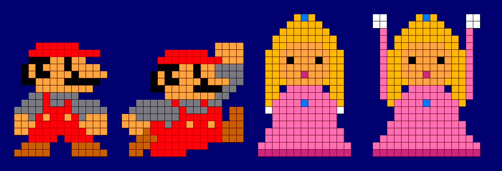

# Brief: ridisegnare lo sprite di Peach

Lo sprite di Peach nell'effetto "Peach Clock" è brutto e va rifatto. Questo file contiene tutto il necessario: com'è oggi, dove si trova, come viene usato e i vincoli tecnici da rispettare.



*Da sinistra: Mario idle, Mario jump (riferimento), Peach idle, Peach jump (da rifare). Ingrandimento 16×, sfondo = colore del cielo.*

## Contesto

- Display: matrice LED **64×64**, colori **RGB565**.
- Effetto: orologio stile Super Mario. Il personaggio sta sul terreno sotto due blocchi "?" (ore e minuti). Quando cambia l'ora o il minuto cammina sotto il blocco, salta, dà una testata al blocco e il numero si aggiorna.
- Peach usa lo stesso effetto e lo stesso sfondo di Mario, cambia solo lo sprite.
- Servono **2 frame**: `IDLE` (ferma o mentre cammina) e `JUMP` (durante il salto). Non c'è un ciclo di camminata.

## Dove si trova

| Cosa | File |
|---|---|
| Palette e pixel di Peach | [ESPCode/include/assets.h](../../ESPCode/include/assets.h), sezione `// ========== PEACH ==========` |
| Sprite di Mario (riferimento di stile) | stesso file, `MARIO_IDLE` / `MARIO_JUMP` |
| Selezione dello sprite | [ESPCode/src/effects/MarioClockEffect.cpp](../../ESPCode/src/effects/MarioClockEffect.cpp), costruttore (`CHARACTER_PEACH`) |
| Rendering (trasparenza, flip) | [ESPCode/src/SpriteRenderer.h](../../ESPCode/src/SpriteRenderer.h) |

## Sprite attuali

Legenda: `.` trasparente, `H` capelli, `J` gemma, `S` pelle, `E` occhi, `P` rosa vestito, `D` rosa scuro, `G` guanti.

**PEACH_IDLE, 13×20**
```
.....HJH.....
....HHHHH....
...HHHHHHH...
..HHHHHHHHH..
..HHSSSSSHH..
.HHSSSSSSSHH.
.HHSESSSESHH.
.HHSSSSSSSHH.
.HHSSSDSSSHH.
.HHHSSSSSHHH.
.HH.PPPPP.HH.
.HHPPPPPPPHH.
.HPPPPJPPPPH.
.GPPPPPPPPPG.
..PPPPPPPPP..
..PPPPPPPPP..
.PPPPPPPPPPP.
.PPPPPPPPPPP.
PPPPPPPPPPPPP
DDDDDDDDDDDDD
```

**PEACH_JUMP, 17×20**
```
.GG....HJH....GG.
.GG...HHHHH...GG.
..P..HHHHHHH..P..
..P.HHHHHHHHH.P..
..P.HHSSSSSHH.P..
..PHHSSSSSSSHHP..
..PHHSESSSESHHP..
..PHHSSSSSSSHHP..
..PHHSSSDSSSHHP..
..PHHHSSSSSHHHP..
..PHH.PPPPP.HHP..
..PHHPPPPPPPHHP..
...HPPPPJPPPPH...
....PPPPPPPPP....
....PPPPPPPPP....
...PPPPPPPPPPP...
...PPPPPPPPPPP...
..PPPPPPPPPPPPP..
.PPPPPPPPPPPPPPP.
.DDDDDDDDDDDDDDD.
```

### Palette attuale

| Costante | RGB565 | ≈ RGB | Uso |
|---|---|---|---|
| `P_HAIR` | `0xFDC0` | `#FFBA00` | capelli |
| `P_SKIN` | `0xFD28` | `#FFA541` | pelle (uguale a Mario) |
| `P_PINK` | `0xFB95` | `#FF71AC` | vestito |
| `P_DPINK` | `0xC94F` | `#CD287B` | bocca, orlo della gonna |
| `P_JEWEL` | `0x03DF` | `#0079FF` | gemma su corona e spilla |
| `P_EYE` | `0x0000` | `#000000` | occhi |
| `P_GLOVE` | `0xFFFF` | `#FFFFFF` | guanti |

## Cosa non funziona

1. **È frontale e simmetrica**, mentre Mario è di profilo e guarda a destra. Accanto a lui sembra una sagoma piatta, e quando cammina il flip orizzontale non cambia nulla, quindi non si capisce dove sta andando.
2. **I capelli sono un blocco giallo unico** che incornicia la faccia fino alle spalle. Non si leggono la corona né la forma della testa.
3. **Il vestito è un trapezio rosa piatto**: niente vita, maniche a sbuffo, pieghe o ombreggiatura. Solo una riga di rosa scuro in fondo.
4. **Nel salto le braccia sono linee rosa di 1 px** che arrivano ai guanti. Sembrano due aste, non braccia. La posa non comunica movimento.
5. **La corona è appena accennata** (3 pixel in cima) e la gemma si confonde con i capelli.
6. **Non ci sono contorni né toni scuri** (Mario usa nero, marrone e grigio per definire i volumi), quindi sul LED si vede una macchia gialla e rosa.

## Vincoli tecnici (da rispettare)

- **Trasparenza**: il colore `0x000E` (`_MASK`, uguale al blu del cielo `SKY_COLOR`) viene saltato in disegno. Non usarlo come colore visibile; qualunque altro valore RGB565 va bene.
- **Orientamento**: disegnare **rivolta a destra**. Quando cammina verso sinistra il codice specchia lo sprite orizzontalmente.
- **Dimensioni**: larghezza e altezza sono libere, ma idle e jump devono avere la **stessa altezza**. Restare intorno a **13–17 px di larghezza e 16–20 px di altezza**. Oggi Peach è alta 20, Mario 16.
- **Posizione**: i piedi poggiano su `y = 56` (il terreno occupa le ultime 8 righe), quindi lo sprite parte da `y = 56 − altezza`. Il personaggio sta circa tra `x = 8` e `x = 40`.
- **Salto**: sale di 3 px ogni 50 ms per al massimo 14 px, oppure finché la testa tocca il blocco. I blocchi sono 19×19 a `y = 8`, con il bordo inferiore a `y = 27`. Con altezza 20 la testa parte da `y = 36`, quindi la testata avviene dopo circa 9 px di salita. Se lo sprite diventa molto più basso di 16 px, potrebbe non arrivare al blocco.
- **La collisione usa il rettangolo dello sprite**: la riga più alta deve essere davvero la cima della testa o della corona, altrimenti nel jump la testata parte dai guanti alzati (come succede oggi, con i guanti alla riga 0).
- **Leggibilità sul LED**: i pixel sono grandi e luminosi. Le sfumature troppo vicine si fondono e il nero risulta "spento", quindi funziona come contorno o vuoto.

## Cosa consegnare

- Due array `PEACH_IDLE` e `PEACH_JUMP` nel formato di `assets.h` (`const uint16_t NOME [] PROGMEM = { ... };`, una riga dopo l'altra da sinistra a destra), con i rispettivi `PEACH_IDLE_SIZE` / `PEACH_JUMP_SIZE`.
- Le costanti `P_*` della palette aggiornate o nuove. Si possono aggiungere colori, per esempio un rosa ombra, un oro più scuro per corona e capelli o un contorno.
- Possibilmente anche una griglia ASCII o un PNG ingrandito, come sopra, per controllarli a colpo d'occhio.

Direzione suggerita: stesso linguaggio di Mario NES/SNES, cioè di profilo verso destra, corona dorata ben visibile, capelli che scendono dietro le spalle, vestito con vita e gonna a campana con ombra, braccia distinguibili. Nel jump: un braccio alzato a pugno e la gonna che si apre.
